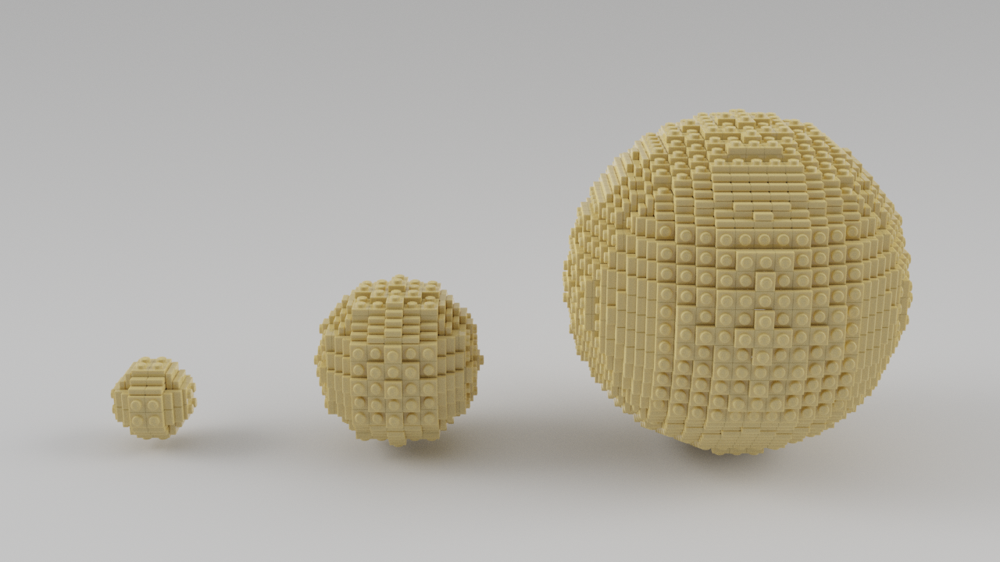
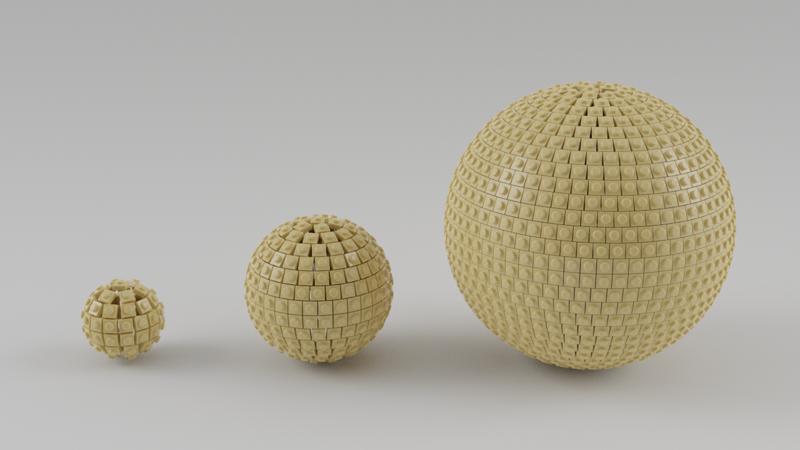
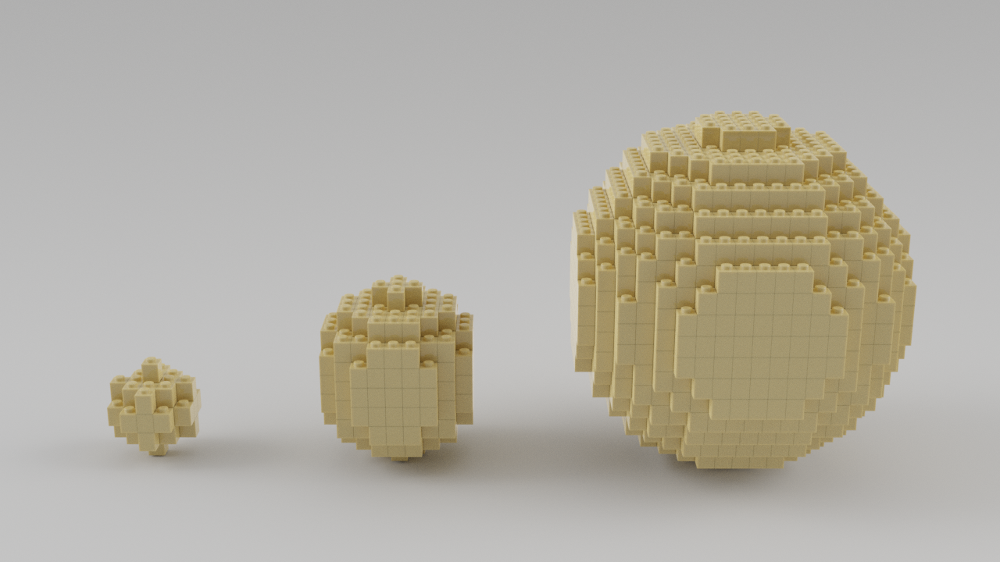
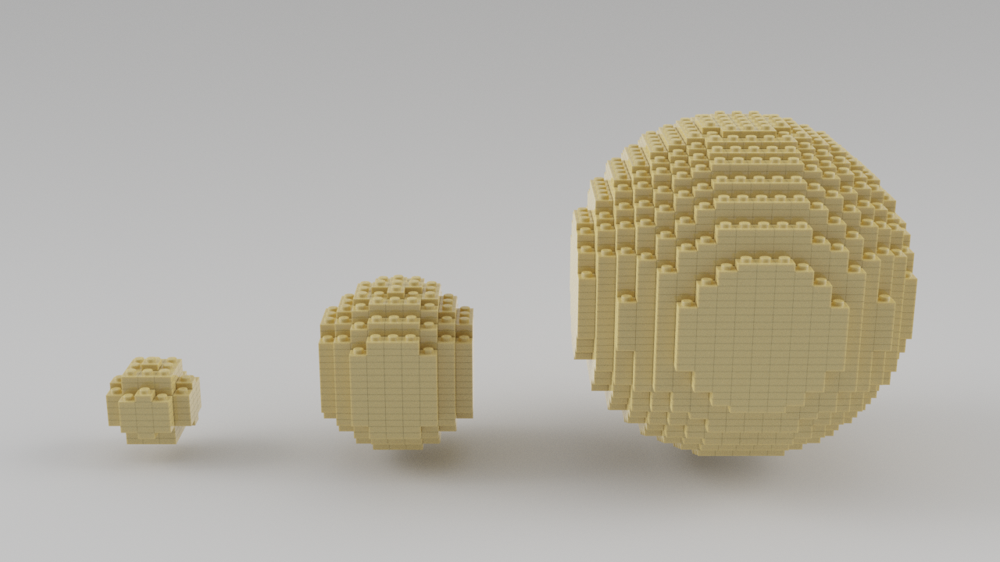

# sphere-generator
This program can generate four types of lego spheres. 

## options
- -o, --output : The name of the output LDraw file to be created.
- -t, --type : Number specifying the type of object to generate.
  - 0 : Sphere made in the Lowell sphere style
  - 1 : Sphere made of 1x1 plates facing outwards.
  - 2 : Sphere made of stacked 1x1 blocks.
  - 3 : Sphere made of stacked 1x1 plates.
- -r, --radius : The radius of the sphere.

## Examples
#### Type 0

#### Type 1

#### Type 2

#### Type 3

